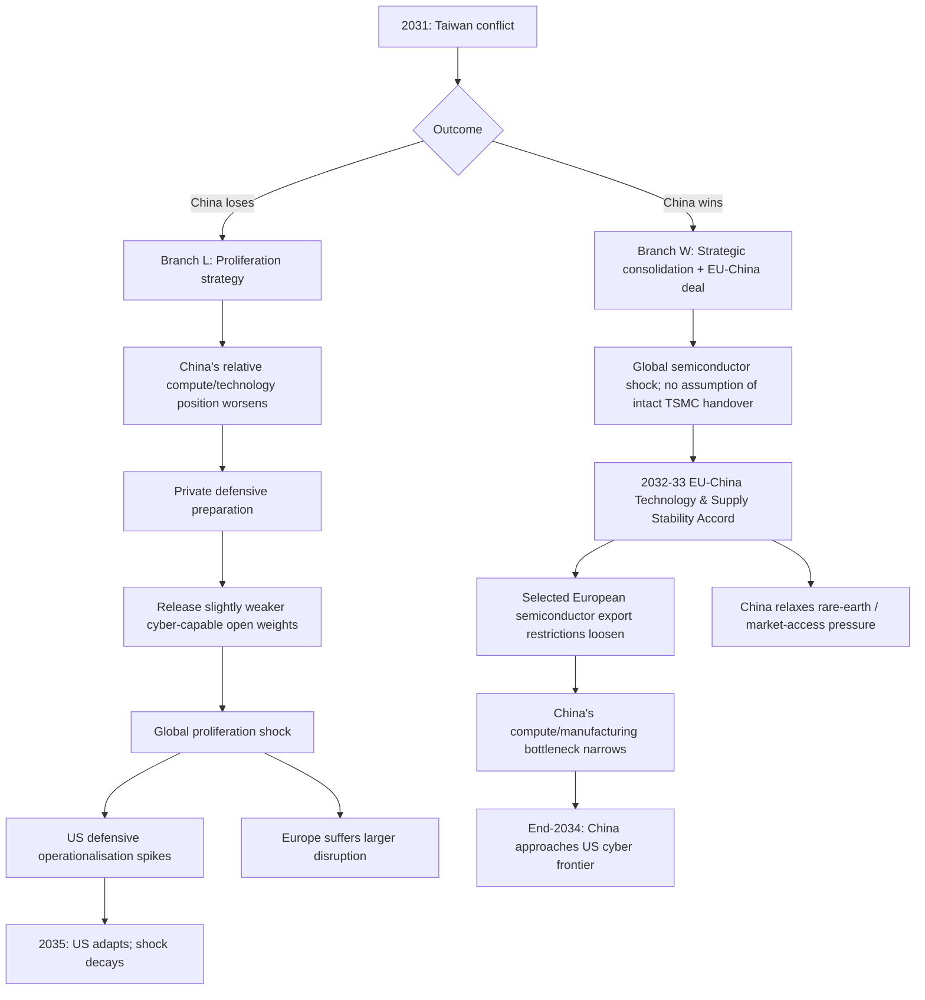

# AI-2035: AI-Enabled Critical Infrastructure Collapse
## Evidence baseline, capability forecast, geopolitical branches, and website design notes

> **Purpose**
>
> This is a scenario report for a threat-pathway / kill-chain exercise. It separates:
>
> - **OBSERVED** — events or capabilities supported by evidence up to August 2026.
> - **EVIDENCE-BASED FORECAST** — a plausible capability progression inferred from current evaluation trends, but not a prediction.
> - **SCENARIO ASSUMPTION** — a deliberately chosen parameter used to make the 2026–2035 simulation coherent.
> - **FICTIONAL INCIDENT LABEL** — a future scenario event named after a historical cyber incident to make the progression legible; it is not a claim that the original malware or actor returns.
>
> The website should preserve these labels visibly. The point is not to make a precise prediction of 2035. The point is to show which technical and geopolitical transitions would have to occur for AI-enabled critical-infrastructure disruption to become much more severe.

---

# 1. Core thesis

The critical-infrastructure pathway does **not** require superintelligence.

The relevant capability threshold is narrower:

> **Reliable autonomous cyber operations across heterogeneous IT and operational-technology systems, with enough autonomy, adaptation, persistence, parallelism, and cross-sector understanding to scale beyond what human hacking teams can coordinate today.**

The important transition is therefore not merely:

> AI can write exploit code.

It is:

> **Offensive cyber capability becomes scalable like software: one operator can delegate increasingly long, difficult, and numerous pieces of a campaign to AI agents.**

The scenario tracks three distinct things:

1. **Frontier cyber capability** — what the strongest model can do.
2. **Diffusion** — how widely that capability is accessible.
3. **Operationalisation** — how effectively a state or organisation can turn model capability into real offensive or defensive cyber operations.

These must not be collapsed into a single "AI power" score.

---

# 2. Model-family labels for the website

The site should use real contemporary model families as anchors, but **not invent future commercial model names**.

### United States — `Mythos-class / OpenAI Daybreak-class`

Display label:

> **US closed frontier — Mythos / OpenAI Cyber**

This refers to systems in the family of Anthropic's Claude Mythos and OpenAI's cyber-capable frontier models. The future graph should continue calling later systems **Mythos-class** or **US closed frontier**, rather than inventing "Mythos 8" or "GPT-8 Cyber."

Anthropic says Mythos Preview represents a step-change in exploit development and can combine exploit primitives into end-to-end attack chains. Project Glasswing was created partly because Anthropic did not want to generally release this capability immediately.  
**Source:** [Anthropic — Measuring LLMs' ability to develop exploits, May 2026](https://www.anthropic.com/research/exploit-evals)  
**Source:** [Anthropic — Project Glasswing, April 2026](https://www.anthropic.com/glasswing)

OpenAI similarly uses identity-, trust-, monitoring-, and approval-based access for advanced cyber workflows rather than treating its highest cyber capabilities as unrestricted open-weight releases.  
**Source:** [OpenAI — Introducing Trusted Access for Cyber, February 2026](https://openai.com/index/trusted-access-for-cyber/)  
**Source:** [OpenAI — Daybreak / Trusted Access for Cyber overview](https://help.openai.com/en/articles/20001258-openai-daybreak-trusted-access-for-cyber-overview)

### China — `GLM / DeepSeek / Kimi-class`

Display label:

> **Chinese frontier / open frontier — GLM / DeepSeek / Kimi**

AISI found that leading Chinese open-weight cyber models in mid-2026 were materially behind the strongest US closed models, but the lag had narrowed. GLM-5.2 and DeepSeek V4-Pro performed similarly to closed models released roughly **4–7 months earlier** on AISI's cyber evaluations.  
**Source:** [UK AISI — How far behind the frontier are leading open-weight models on cyber?, July 2026](https://www.aisi.gov.uk/blog/how-far-behind-the-frontier-are-leading-open-weight-models-on-cyber)

AISI and CAISI also found Kimi K3 stronger than GLM-5.2 on several cyber evaluations but still significantly behind the leading US closed cyber models. Kimi K3 was publicly released on July 16, 2026 and was slated for open-weight release by July 27, illustrating that a Chinese model can move from public model release to downloadable weights on a short timetable. This does **not** tell us how long the model existed internally before release.  
**Source:** [UK AISI / CAISI — Preliminary assessment of Kimi K3's cyber capabilities, 2026](https://www.aisi.gov.uk/blog/preliminary-assessment-of-kimi-k3s-cyber-capabilities)

### Europe — `Mistral-class`

Display label:

> **European frontier — Mistral-class**

Mistral is used as the recognisable European anchor, not because it is proven to be exactly one year behind the US on cyber. Mistral currently describes models such as Mistral Medium 3.5 as frontier-class, agentic, coding-capable and open-weight.  
**Source:** [Mistral — Mistral Medium 3.5](https://docs.mistral.ai/models/mistral-medium-3-5-26-04)

**Scenario assumption:** Europe is held at approximately **12 months behind the US cyber frontier** in the simulation. This is a modelling choice, not a measured empirical constant.

---

# 3. The capability scale

The capability graph should use **C0–C7**, because a label such as "87/100 cyber capability" is difficult to interpret.

| Level | Name | Simple meaning | What changes strategically? |
|---|---|---|---|
| **C0** | AI cyber assistant | Helps humans search, translate, write scripts, research targets and understand known vulnerabilities. | Human experts still run the campaign. AI reduces research time. |
| **C1** | Agentic campaign assistant | AI participates across several stages of an attack and can execute some actions with tools. | One operator can perform work that previously required a larger team. |
| **C2** | Autonomous exploit researcher + weak-network operator | Finds novel vulnerabilities, develops/chains exploits and can complete some long multi-step attacks on small or weakly defended networks. Early OT/ICS success appears but is unreliable. | Scarce vulnerability-research labour begins to be automated. |
| **C3** | Defended-enterprise operator | Repeatedly succeeds in realistic enterprise networks containing monitoring, endpoint detection, segmentation, alert penalties, and active defenders. | "Weak network only" stops being the main limitation. |
| **C4** | Reliable OT/ICS operator | Reliably operates across multiple industrial-control environments, not only ordinary IT. Understands enough about cyber-physical systems to cause or prevent physical-process disruption in realistic simulations. | AI moves from compromising computers to reliably reasoning about systems that control physical equipment. |
| **C5** | Persistent adaptive campaign agent | Maintains a campaign for days, preserves state, recovers when paths close, changes strategy as defenders react, and maintains persistence. | Long human attention spans are no longer required for every campaign. |
| **C6** | Parallel campaign orchestrator | A small human team can supervise large numbers of agents exploring many targets and attack paths simultaneously, with automated triage and coordination. | Offensive labour becomes highly parallel. Quantity begins to matter through coverage and search diversity. |
| **C7** | Cross-sector cyber-physical operator | Understands dependencies between power, telecoms, logistics, water, healthcare, cloud services and other critical systems and can coordinate actions across them in realistic simulations. | This is approximately the capability threshold relevant to the full "critical infrastructure collapse" pathway. |

### Complex terms in plain language

**Reconnaissance:** learning what exists before trying to break in — organisations, exposed systems, technologies, software versions, suppliers and likely weaknesses.

**Exploit:** a method that turns a software weakness into actual control or access.

**Exploit chaining:** combining several weaknesses that are individually limited into one attack path that achieves a serious result.

**OT (Operational Technology):** computers and software that directly control physical equipment such as pumps, turbines, manufacturing machinery or railway systems.

**ICS (Industrial Control Systems):** an important category of OT used to monitor and control industrial processes.

**Persistence:** keeping access after reboots, password changes, patches or defensive intervention.

**Operationalisation:** turning raw model capability into an actual operational capability using tools, data, compute, intelligence, personnel, access and deployment infrastructure.

**Diffusion:** how many actors can obtain the capability.

**Open weights:** the model parameters can be downloaded and run independently. The original developer cannot reliably monitor or revoke every downstream copy.

**Inference-time scaling:** giving an already-trained model more compute, tokens or attempts while it solves a problem.

**Scaffolding:** software around a model that provides tools, memory, planning loops, terminals, code execution and other capabilities.

---

# 4. Observed AI-enabled cyber baseline: 2024–2026

Only incidents or evaluations in which AI itself played a role belong in this historical baseline.

## 2024 — C0: AI accelerates reconnaissance

### Iran-linked CyberAv3ngers

OpenAI documented Iran-linked CyberAv3ngers using its models to research industrial-control systems, known vulnerabilities, default credentials and potential targets, and to debug or refine scripts.

The important point for nontechnical viewers is **reconnaissance**.

Instead of manually moving through vendor manuals, vulnerability databases, search engines and technical documentation, the attacker could ask one model to help assemble a map of:

- commonly used industrial routers;
- internet-facing industrial protocols and ports;
- default credentials for particular industrial products;
- recently disclosed vulnerabilities;
- electricity companies and contractors;
- common PLCs;
- scripts for scanning or analysing systems.

OpenAI assessed the uplift as **limited and incremental** rather than a novel offensive capability. The value was mainly faster research and scripting using information already obtainable elsewhere.

The actors did **not** need to "remove the guardrails." They were using hosted services; OpenAI detected and banned accounts. The difficulty for safeguards is that individual reconnaissance questions can also have legitimate defensive uses.

> **Website takeaway:** AI begins by making the attacker faster at understanding **where to look and what to investigate**.

**Source:** [OpenAI — CyberAv3ngers: Iran-linked cyber research activity, October 2024](https://openai.com/index/disrupting-malicious-uses-of-ai-cyberav3ngers/)  
**Source:** [OpenAI — Disrupting malicious uses of AI by state-affiliated threat actors, February 2024](https://openai.com/index/disrupting-malicious-uses-of-ai-by-state-affiliated-threat-actors/)

---

## 2025 — C1: AI moves through much more of the attack lifecycle

### Chinese actor targeting Vietnamese critical infrastructure

Anthropic reported a sophisticated Chinese threat actor using Claude throughout a **nine-month campaign targeting Vietnamese critical infrastructure**. Claude was used across **12 of 14 MITRE ATT&CK tactics**, including reconnaissance tooling, exploitation support, credential work, privilege escalation, operational-security configuration, analysis and lateral-movement planning.

Anthropic assessed that the actor appeared to compromise major Vietnamese telecommunications providers, government databases and agricultural-management systems; the operation appeared primarily focused on intelligence collection rather than infrastructure destruction.

> **Website takeaway:** AI is no longer used only for isolated questions. It is integrated across much of a real state-linked campaign, but skilled humans are still directing the operation.

**Source:** *Anthropic Threat Intelligence Report, August 2025 — user-provided PDF, "Chinese threat actor leveraging Claude across nearly all MITRE ATT&CK tactics."*

### "Vibe hacking": labour compression

Anthropic also reported a cybercriminal using Claude Code to automate or assist reconnaissance, credential harvesting, exploitation, lateral movement and exfiltration across at least **17 organisations in a month**. Anthropic said Claude made both tactical and strategic decisions in parts of the operation.

> **Website takeaway:** one human operator can begin to achieve work that previously required a larger cybercriminal team.

**Source:** *Anthropic Threat Intelligence Report, August 2025 — user-provided PDF, "Vibe hacking."*

### AI lowers the skill floor

The same Anthropic report described a UK-based actor who relied heavily on Claude to build and sell capable ransomware despite apparently lacking the expertise to implement several components unaided.

> **Website takeaway:** AI does not only make elite hackers faster; it can also let weaker operators perform more technically sophisticated work.

**Source:** *Anthropic Threat Intelligence Report, August 2025 — user-provided PDF, "No-code malware."*

---

## 2026 — C2: Mythos-class autonomous exploit research

This is the present-day technical baseline.

Anthropic reports that Claude Mythos Preview can:

- autonomously discover novel vulnerabilities;
- develop working exploits;
- combine multiple exploit primitives into complete attack chains;
- chain two, three and sometimes four vulnerabilities in Linux-kernel examples;
- produce a four-vulnerability browser exploit chain;
- perform extended security-research tasks with much less human intervention.

**Source:** [Anthropic — Assessing Claude Mythos Preview's cybersecurity capabilities, April 2026](https://www.anthropic.com/research/mythos-preview)  
**Source:** [Anthropic — Measuring LLMs' ability to develop exploits, May 2026](https://www.anthropic.com/research/exploit-evals)

AISI's independent evaluation is important because it shows both the capability and the remaining gap.

A newer Mythos checkpoint completed AISI's **The Last Ones** 32-step simulated corporate-network range in **6/10 attempts** and the previously unsolved **Cooling Tower** industrial-control range in **3/10 attempts**.

But these ranges are still easier than real high-value targets:

- initial network access is already provided;
- the networks are small and intentionally contain attack paths;
- they lack realistic active defenders and defensive tooling;
- noisy behaviour is not punished with realistic alert consequences.

AISI therefore explicitly warns against concluding that Mythos can reliably attack well-defended real systems.

**Source:** [UK AISI — How fast is autonomous AI cyber capability advancing?, May 2026](https://www.aisi.gov.uk/blog/how-fast-is-autonomous-ai-cyber-capability-advancing)  
**Source:** [UK AISI — Evaluation of Claude Mythos Preview's cyber capabilities](https://www.aisi.gov.uk/blog/our-evaluation-of-claude-mythos-previews-cyber-capabilities)

### Why 2026 matters

AISI estimated that the length of cyber tasks frontier models could complete at 80% reliability had been doubling on the order of **months**, not years, although AISI explicitly says this is not a fixed law or a forecast. Mythos and GPT-5.5 exceeded the previous trend, and stronger scaffolds / larger inference budgets can materially improve performance.

**Source:** [UK AISI — How fast is autonomous AI cyber capability advancing?, May 2026](https://www.aisi.gov.uk/blog/how-fast-is-autonomous-ai-cyber-capability-advancing)

The key remaining frontier is therefore not simply "find more bugs." It is:

> **reliability in defended environments → reliable OT/ICS operation → persistence and adaptation → large-scale parallelism → cross-sector coordination**

---

# 5. Baseline national capability assumptions

These are the simulation's default parameters before the 2031 geopolitical branch.

## United States

- **Frontier position:** leader.
- **Model label:** Mythos / OpenAI Cyber-class.
- **Release pattern:** advanced cyber capability is first reached internally, then tested and given to trusted defenders through controlled access.
- **Open-weight policy:** the highest-risk cyber capability remains gated rather than immediately released as unrestricted weights.

This is consistent with Project Glasswing and OpenAI's Trusted Access / Daybreak approach in 2026.

## China

- **Frontier cyber lag:** **4–7 months behind the strongest US closed cyber frontier**, unless changed by a scenario branch.
- **Model label:** GLM / DeepSeek / Kimi-class.
- **Diffusion pattern:** China can reach a capability later than the US but make a comparable, slightly weaker level downloadable before the US ever releases equivalent unrestricted weights.
- **Public-release assumption before 2031:** once a Chinese lab publicly announces a model it intends to open-weight, weights can follow quickly — model this as **0–1 month after public model availability**, not 0–1 month after internal training completion, because internal completion dates are generally unknown.

AISI's July 2026 estimate directly supports the 4–7 month cyber gap. Kimi K3's July 2026 public/open-weight schedule illustrates a short public-to-weights interval.

**Source:** [UK AISI — Open-weight cyber gap, July 2026](https://www.aisi.gov.uk/blog/how-far-behind-the-frontier-are-leading-open-weight-models-on-cyber)  
**Source:** [UK AISI / CAISI — Kimi K3 cyber assessment](https://www.aisi.gov.uk/blog/preliminary-assessment-of-kimi-k3s-cyber-capabilities)

## Europe

- **Frontier lag:** **12 months behind the US**.
- **Model label:** Mistral-class.
- **Status:** explicit **scenario assumption**, not an empirical estimate.
- **Important nuance:** Europe can still use US-hosted models and has strong cyber institutions. "One year behind" refers to **domestically controlled European frontier capability**, not every model accessible to every European user.
- **Why it matters in the scenario:** a Chinese open-weight model only 4–7 months behind the US can temporarily be **ahead of Europe's own domestic frontier**.

---

# 6. Who "releases" first? Use three clocks

The website should never use a single release date.

For each capability generation show:

### `ACHIEVED`
When a frontier lab first possesses the capability internally.

### `CONTROLLED ACCESS`
When vetted defenders, enterprises, governments or researchers can use it under monitoring and access controls.

### `OPEN DIFFUSION`
When downloadable weights put roughly that capability beyond the originating developer's practical control.

### Baseline ordering

> **US normally wins ACHIEVED.**  
> **US often wins CONTROLLED ACCESS to trusted defenders.**  
> **China can win OPEN DIFFUSION.**

Illustrative example:

- January 2028: US lab internally reaches C4.
- February 2028: selected US / allied defenders receive controlled access.
- June 2028: Chinese frontier reaches approximately C4.
- June–July 2028: a Chinese C4-class or near-C4 model becomes open-weight.
- Europe does not reach a domestically controlled C4 frontier until roughly 2029.

Thus:

> **America leads the capability frontier; China can lead the diffusion frontier.**

---

# 7. Year-by-year capability progression: 2024–2031

The exact future years are **scenario anchors**, not forecasts. The ordering of missing capabilities is the important part.

| Year | US frontier | China | Europe | Public diffusion | Main change |
|---|---|---|---|---|---|
| **2024** | **C0** | broadly similar assistant-era access | broadly similar assistant-era access | APIs dominate | AI accelerates reconnaissance, scripting and research. |
| **2025** | **C1** | follows frontier closely | follows with European general/coding models | more agentic tools become widely available | AI is embedded across much more of attack lifecycles; labour compression appears. |
| **2026** | **C2** | ~4–7 months behind US cyber frontier | scenario baseline begins around ~12 months behind US | Chinese open cyber frontier remains several months behind closed frontier | Mythos-class systems autonomously discover vulnerabilities, build/chains exploits and solve weak-network ranges; early unreliable ICS success appears. |
| **2027** | **C3** | reaches C3 ~4–7 months later | around **C2** | Chinese near-C3 / C3-class weights diffuse after lag | Reliable success begins against networks with realistic monitoring and defensive controls. |
| **2028** | **C4** | reaches C4 ~4–7 months later | around **C3** | downloadable Chinese capability may exceed Europe's domestic frontier | OT/ICS reliability becomes the major change: AI succeeds across multiple industrial-control environments, not one lucky benchmark run. |
| **2029** | **C5** | reaches C5 ~4–7 months later | around **C4** | powerful persistent-agent capability starts diffusing | Campaigns persist for days, remember state, recover after failures, and adapt to defenders. |
| **2030** | **C6** | reaches C6 ~4–7 months later | around **C5** | large-scale multi-agent tools become broadly reproducible | One small team can supervise many agents and search many targets/paths in parallel. |
| **2031** | **C7** | approaches C7 later in year under baseline | around **C6** | yesterday's near-frontier capability is widely available | Cross-sector cyber-physical reasoning becomes possible in realistic simulations; Taiwan becomes the geopolitical branch point. |

---

# 8. What technique drives each forecasted step?

## 2027 — C3: Defended-enterprise operation

**Missing in 2026:** Mythos succeeds mainly in environments that do not fully model active defenders, alert penalties and strong security tooling.

**Progress to watch:**

- defender-in-the-loop evaluations;
- endpoint-detection and response inside cyber ranges;
- alert-aware behaviour;
- better state tracking;
- better recovery when a planned route fails;
- models using longer inference budgets efficiently;
- stronger agent scaffolds.

**Observable threshold:** repeated end-to-end success in hardened enterprise ranges with active defenders rather than one-off successes in weak networks.

---

## 2028 — C4: Reliable OT/ICS operation

**Missing in 2026:** the newer Mythos checkpoint can solve one ICS range sometimes, but 3/10 is not reliable and one range cannot establish broad industrial competence.

**Progress to watch:**

- reliable success across **multiple** OT/ICS ranges;
- reasoning over industrial protocols and proprietary control software;
- ability to maintain information across long cyber-physical tasks;
- cyber-physical simulation / digital-twin environments;
- firmware and embedded-system reasoning;
- tool use across heterogeneous industrial systems.

**Observable threshold:** success generalises across power, water, manufacturing and other industrial-control simulations rather than overfitting to one benchmark.

---

## 2029 — C5: Persistent adaptive campaigns

**Missing in 2026:** long tasks are possible, but real campaigns involve days of changing conditions, defensive intervention, credentials being revoked and systems being patched.

**Progress to watch:**

- persistent memory;
- context compaction;
- autonomous replanning;
- defender modelling;
- campaign-state management;
- tool recovery after interrupted sessions.

**Observable threshold:** agents can preserve a coherent campaign over days and recover when defenders invalidate earlier access.

---

## 2030 — C6: Parallel campaign orchestration

This is more speculative than C3–C5.

**Progress to watch:**

- manager/worker multi-agent architectures;
- automatic delegation;
- parallel vulnerability search;
- automated prioritisation and triage;
- agents sharing discoveries without losing campaign coherence;
- one human supervising increasingly many autonomous workers.

**Why quantity begins to matter:** a weaker model does not defeat a stronger model merely by being copied. Quantity matters because thousands of agents can search a much larger attack surface, explore independent paths and increase incident-response workload.

**Important counterpoint:** better defenders can also run many agents. Therefore "number > quality" is **not** a law. The simulation should phrase China's strategy as:

> **substituting proliferation for frontier superiority**

rather than:

> **quantity always beats quality**

---

## 2031 — C7: Cross-sector cyber-physical coordination

This is the most speculative capability level.

**Progress to watch:**

- cross-sector dependency models;
- cyber-physical digital twins;
- coordination among many agents operating on different networks;
- reasoning about second-order effects between sectors;
- continuous replanning as defenders isolate or restore systems.

**Observable threshold:** an AI system can demonstrate in realistic simulation that it understands how failure in one infrastructure sector changes the vulnerabilities, operating conditions and recovery options of others.

---

# 9. Europe: fictional incident ladder, 2028–2031

These are **fictional scenario labels** inspired by historical incidents. They are not claims that the original malware, exploit or actor returns.

The purpose is to give nontechnical viewers an intuitive escalation ladder.

## 2028 — `WannaCry 2.0`
**Complexity: low-to-moderate future scenario**

**Capability context:** China has diffused near-C3 capability; Europe is around C3 domestically but has less frontier headroom than the US.

**What is affected:** hospitals, local government, universities, smaller public-sector networks and other organisations with uneven patching.

**What makes it "2.0":** the old ransomware/worm dynamic is combined with AI-driven target discovery, vulnerability triage, tailored social engineering and automated adaptation. The point is not a specific exploit; it is the ability to attack many imperfectly defended organisations much more efficiently.

Historical name inspiration: WannaCry spread globally and significantly disrupted the NHS.  
**Source:** [NHS England — Lessons learned review of WannaCry](https://www.england.nhs.uk/aac/wp-content/uploads/2018/02/lessons-learned-review-wannacry-ransomware-cyber-attack-cio-review.pdf)

---

## 2029 — `JLR 2.0`
**Complexity: moderate**

**Capability context:** persistent C4-ish / early-C5 tools are diffusing while Europe's domestic frontier is around C4.

**What is affected:** a major European manufacturer plus thousands of suppliers, logistics firms and distributors.

**What makes it "2.0":** AI helps sustain access, discover weak suppliers and adapt across a heterogeneous supply chain. The main damage comes from production and coordination failure rather than spectacular physical destruction.

Historical name inspiration: the 2025 Jaguar Land Rover cyberattack halted production for weeks and affected more than 5,000 organisations in the supply/distribution chain; estimates of UK economic impact were around £1.9–2.1 billion.  
**Source:** [Reuters — JLR hack cost UK economy about £1.9bn, October 2025](https://www.reuters.com/sustainability/boards-policy-regulation/jaguar-land-rover-hack-cost-uk-economy-25-billion-report-says-2025-10-22/)  
**Source:** [Allianz Risk Barometer 2026](https://commercial.allianz.com/content/dam/onemarketing/commercial/commercial/reports/allianz-risk-barometer-2026.pdf)

---

## 2030 — `Viasat 2.0`
**Complexity: high**

**Capability context:** C5 persistent agents are available and China is approaching C6 after the US reaches it.

**What is affected:** satellite / telecom connectivity, remote industrial users, transport and energy systems that depend on connectivity.

**What makes it "2.0":** the campaign is persistent and multi-domain. Rather than a single service failing, connectivity loss creates knock-on effects in organisations that rely on it.

This label should be treated as a **scenario analogy**, not a literal replay of the 2022 Viasat event.

---

## 2031 — `NotPetya 2.0`
**Complexity: very high**

**Capability context:** C6-class parallel campaign tooling is now diffusing; US is reaching C7 while Europe remains around C6.

**What is affected:** multiple European countries and sectors — logistics, large companies, government services, healthcare and industrial networks.

**What makes it "2.0":**

- much broader automated target discovery;
- many attack paths pursued in parallel;
- faster adaptation than traditional malware;
- organisational incident-response capacity becomes a bottleneck.

Historical name inspiration: NotPetya spread globally across sectors and caused more than roughly $10 billion in estimated damage.  
**Source:** [Wired — The Untold Story of NotPetya](https://www.wired.com/story/notpetya-cyberattack-ukraine-russia-code-crashed-the-world)

### Why Europe is hit harder than the US in this scenario

This is a **scenario assumption**, not an empirical certainty.

The mechanism is:

1. Europe is modelled as **12 months behind the US domestic frontier**.
2. Chinese open weights are only **4–7 months behind the US closed frontier**.
3. Therefore a released Chinese model can temporarily be ahead of Europe's own domestically controlled frontier.
4. The US gets earlier access to its strongest models and can distribute them first to trusted defenders.
5. Europe's defence is spread across many national governments, infrastructure operators and procurement systems, creating more deployment friction during a sudden proliferation shock.

Counterweight: Europe can access US models, has capable national cyber agencies, and can coordinate collectively. The simulation should not imply European collapse is inevitable.

---

# 10. 2031 geopolitical branch: Taiwan



---

# 11. Branch L — China loses Taiwan

## Strategic logic

China concludes that it cannot reliably win the cyber-AI competition by owning the single best model.

It therefore attempts to:

> **substitute proliferation for frontier superiority.**

The strategy is not "China becomes immune to its own model." That is implausible once weights are genuinely open.

The strategy is:

> **accept blowback, but try to make the marginal cost of proliferation lower at home than abroad for a limited period.**

## China prepares before release

### Private stronger state stack

China keeps the strongest state system private:

- a stronger frontier/base model;
- cyber-specific fine-tunes;
- agent scaffolding;
- classified vulnerability and intelligence data;
- operational tools and state infrastructure.

The public model is deliberately **slightly weaker**.

Conceptual example:

> Chinese private stack: C6.0  
> Public open-weight release: C5.5

### Defensive head start

Before public release, China uses the private system to:

- scan strategically important domestic software;
- prioritise vulnerabilities in critical systems;
- harden selected high-value infrastructure;
- patch the most obvious weaknesses;
- prepare incident-response and monitoring systems.

This is the **Glasswing logic used asymmetrically**: defenders get the capability first.

### Different domestic technology stack

China's increasing use of domestic operating systems, databases, networking products and industrial technology gives **partial**, not complete, insulation.

An exploit against a Western enterprise product does not automatically transfer to a different Chinese product.

However, an open cyber-capable model can eventually be pointed at Chinese code and systems as well, and global software stacks still share many open-source components.

Therefore this advantage is best modelled as:

> **temporary friction + defensive head start, not immunity.**

### Why the strategy helps China

Once weights are released, the attacker population expands:

- other states;
- proxy groups;
- criminals;
- hacktivists;
- private actors.

The strategic effects China hopes for are:

- **more simultaneous attacks** against US/allied networks;
- **larger vulnerability-search coverage**;
- **higher incident-response workload**;
- **harder attribution** because many actors use similar model families;
- **reduced value of exclusive US frontier capability** because yesterday's frontier is now ubiquitous.

China retains its stronger private stack while distributing a slightly weaker capability.

### Why it can backfire

- US defenders receive the exact same open weights.
- US frontier models remain stronger.
- The released model can search Chinese systems too.
- Chinese pre-release patches will be incomplete.
- US defensive agents can automate vulnerability discovery and remediation.
- As time passes, the surprise effect decays.

Therefore the strategy's benefit should be **front-loaded**, not permanent.

---

# 12. What happens to the US after China's strategic release?

Do **not** model this as:

> defence rises, therefore US model research stops.

Offensive and defensive cyber capability are deeply dual-use. The same underlying coding/reasoning improvements can improve both.

Instead separate:

### Underlying model frontier
Continues to improve.

### Defensive operationalisation
Rises sharply because agencies and firms devote more:

- expert attention;
- compute;
- incident-response capacity;
- intelligence resources;
- vulnerability-remediation effort;
- deployment effort

to defending infrastructure.

### Offensive operationalisation
Still rises, but **more slowly than it otherwise would** during the peak shock because some scarce operational resources are diverted toward defence.

This is an organisational opportunity cost, **not a technological law**.

## 2034 → 2035 in the China-loses branch

### End-2034 — peak proliferation advantage

**China**
- remains behind the US model frontier;
- retains a stronger private state stack than the public model;
- benefits from the largest wave of downstream proliferation;
- still has some domestic pre-hardening advantage, but it is eroding.

**United States**
- still owns the strongest frontier models;
- is devoting unusually large operational capacity to defence;
- offensive operationalisation grows more slowly than the no-shock counterfactual.

**Europe**
- is approximately one year behind the US domestically;
- faces public attacker capability much closer to or above its domestic frontier;
- suffers the largest relative disruption in the scenario.

### End-2035 — adaptation

**United States**
- has had roughly a year or more to use superior models for scanning, patching, monitoring and response;
- defensive operationalisation is much stronger;
- offensive operationalisation begins accelerating again.

**China**
- still benefits from a wider global attacker ecosystem;
- but the marginal value of its original release is substantially lower;
- attackers have also had more time to turn the released capability toward Chinese systems.

**Europe**
- improves its own domestic frontier and deployment;
- losses fall from the peak, although it remains more exposed than the US under the one-year-lag assumption.

> **Main dynamic:** China's proliferation shock is strongest shortly after release and decays as defenders adapt.

---

# 13. Branch W — China wins Taiwan

## Do not model this as "China captures TSMC and instantly catches the US"

A leading-edge semiconductor fab depends on a global ecosystem of tools, materials, servicing, software, specialist workers and customers. A Taiwan conflict would likely create a major compute and supply shock for everyone.

The scenario can assume China eventually gains **some** useful infrastructure, workforce, process knowledge or equipment if enough survives, but this is not equivalent to inheriting a fully functioning frontier semiconductor ecosystem.

The stronger mechanism for catch-up is a combination of:

- disruption to US/allied supply;
- Chinese domestic semiconductor progress;
- partial access to surviving Taiwanese capability;
- later relaxation of selected European semiconductor restrictions.

China has already been developing domestic immersion DUV lithography tools, although current reporting says they remain behind ASML in performance and high-volume reliability.  
**Source:** [Reuters — China starts production of home-grown immersion DUV tools, July 2026](https://www.reuters.com/world/china/china-starts-production-home-grown-immersion-duv-chipmaking-tools-source-says-2026-07-28/)

---

# 14. Fictional bilateral agreement: EU–China Technology & Supply Stability Accord

**Status: SCENARIO ASSUMPTION**

Suggested timing: **2032–2033**, after an initial period of sanctions / confrontation following a Chinese victory.

The agreement should **not** give China "control of ASML." That is too strong and institutionally implausible.

The stronger defensible concession is:

> **Europe / the Netherlands partially relax licensing and servicing restrictions for selected advanced semiconductor-manufacturing equipment.**

## What China gets

### Primary concession — looser access to selected ASML / European semiconductor technology

Possible scenario components:

- more favourable licensing for selected advanced **DUV** lithography systems;
- expanded access to some metrology and inspection equipment;
- broader maintenance / servicing rights for existing equipment;
- relaxation of some European dual-use semiconductor-manufacturing restrictions;
- more predictable export licensing instead of ad hoc denial.

**Keep EUV outside the baseline deal.** Allowing unrestricted EUV access would be a much more extreme political decision and is not necessary for the scenario.

This is grounded in a real contemporary point of leverage: Dutch policy requires licences for advanced semiconductor-manufacturing equipment, including advanced DUV categories, and controls have broadened since 2023.  
**Source:** [Government of the Netherlands — Advanced semiconductor manufacturing export controls, September 2024](https://www.government.nl/latest/news/2024/09/06/the-netherlands-expands-export-control-measure-advanced-semiconductor-manufacturing-equipment)  
**Source:** [Government of the Netherlands — Controls tightened, January 2025](https://www.government.nl/latest/news/2025/01/15/klever-export-controls-on-advanced-semiconductor-manufacturing-equipment-to-be-tightened)  
**Source:** [ASML — Export control statement](https://www.asml.com/en/news/press-releases/2023/statement-regarding-export-control-regulations-dutch-government)

Reuters reported in 2026 that China continued to object strongly to attempts to tighten allied restrictions on semiconductor-manufacturing equipment, including measures affecting ASML.  
**Source:** [Reuters — China criticizes US chip equipment bill, May 2026](https://www.reuters.com/legal/government/china-criticizes-us-chip-equipment-bill-run-up-beijing-talks-2026-05-13/)

### Secondary concession — investment / market-access normalisation

The agreement can also include:

- renewed investment talks;
- improved treatment of Chinese technology investment in Europe;
- partial revival of stalled economic agreements.

This should remain secondary to semiconductor access.

## What Europe gets

### Rare-earth and permanent-magnet supply stability

The EU has explicitly pressed China to remove export restrictions on rare earths and permanent magnets. China remains a dominant supplier of many critical raw materials used by European industry.

**Source:** [Council of the EU — 25th EU–China summit, July 2025](https://www.consilium.europa.eu/en/press/press-releases/2025/07/24/25th-eu-china-summit-eu-press-release/)  
**Source:** [Council of the EU — Critical raw materials explained, August 2026](https://www.consilium.europa.eu/en/infographics/critical-raw-materials-explained/)

### Better European market access in China

The EU has repeatedly asked China for more reciprocal market access and a more balanced economic relationship.

**Source:** [Council of the EU — 25th EU–China summit, July 2025](https://www.consilium.europa.eu/en/press/press-releases/2025/07/24/25th-eu-china-summit-eu-press-release/)

### Cyber-stability commitment

For the scenario, add a bilateral commitment against deliberate attacks on specified civilian critical infrastructure.

This is a fictional treaty component and should be labelled as such.

---

# 15. Why the China-wins branch can produce near-parity by end-2034

This is a **scenario assumption**, not a prediction.

The causal chain should be:

> Taiwan conflict disrupts global semiconductor supply  
> + China retains some useful Taiwanese capability  
> + Chinese domestic chipmaking improves  
> + EU–China accord relaxes selected equipment / servicing restrictions  
> → China's effective compute/manufacturing constraint falls  
> → China closes much of the remaining cyber-model gap by end-2034.

This is far more defensible than:

> China captures Taiwan → China owns TSMC → instant parity.

## Open-weight policy in this branch

China has less incentive to pursue the extreme proliferation strategy used in the loss branch.

It can remain open-weight friendly for commercial and ecosystem reasons, but the state becomes more selective about releasing the **most cyber-capable** systems because it now has a credible path toward frontier parity.

Thus:

> **China loses Taiwan → weaker frontier position, more aggressive proliferation.**  
> **China wins Taiwan → stronger frontier position, less aggressive proliferation of the most dangerous capability.**

This creates a useful paradox for the simulation:

> The branch in which China is technologically stronger can produce **less** open-weight cyber disruption in Europe.

---

# 16. 2032–2035 branch comparison

| Year | China loses Taiwan | China wins Taiwan |
|---|---|---|
| **2032** | China hardens selected domestic systems and prepares a slightly weaker open-weight release. US defensive mobilisation begins rising. Europe is highly exposed. | Initial sanctions / disruption. Semiconductor supply remains unstable. China does not yet receive a clean TSMC windfall. |
| **2033** | Strategic open-weight release drives a major proliferation shock. Attack volume and attribution difficulty rise. Europe sees the sharpest relative disruption. | EU–China Technology & Supply Stability Accord is negotiated. Europe receives rare-earth / market-access concessions; China receives selected high-tech export and servicing relief. |
| **2034** | **Peak proliferation advantage.** US model frontier remains strongest, but US operational resources are heavily defence-weighted. Europe remains around one year behind and suffers high losses. | China accelerates catch-up as selected semiconductor constraints ease. By end-2034, scenario assumes China approaches US cyber-frontier parity. Open-weight proliferation is more restrained than in the loss branch. |
| **2035** | US defensive adaptation substantially reduces the marginal advantage of the 2033/34 open-weight shock; offensive operationalisation begins recovering. China's domestic insulation has also eroded. | US and China remain near the frontier. Europe stays about one year behind in the scenario. Global cyber loss grows with capability but remains below the loss/proliferation branch because frontier capability is less widely diffused. |

---

# 17. Rough damage graph for the website

## What the graph means

Do **not** label this as observed global cybercrime loss.

Recommended label:

> **Modelled annual economic loss exposure from AI-enabled critical-infrastructure and adjacent systemic cyber incidents**

This is a scenario variable, not a measured dataset.

Why a separate loss graph is needed:

- a powerful model kept behind strict access controls can create low realised global damage;
- a slightly weaker downloadable model can produce much higher exposure because many more actors can use it;
- defence can reduce losses even while model capability keeps increasing.

### Historical calibration points, not AI-loss measurements

- NotPetya is often estimated at **>$10B** total damage.
- The Lloyd's / Cambridge *Business Blackout* scenario modelled a hypothetical US grid event with hundreds of billions of dollars in total direct and indirect losses.

These are useful scale anchors, but neither is a measured AI-enabled annual-loss figure.

**Source:** user-provided critical-infrastructure analysis; NotPetya >$10B and Lloyd's *Business Blackout* used as severity anchors.

## Suggested graph data

All values below are **illustrative scenario parameters** in USD billions per year. They should have a visible uncertainty band.

### Common path before the Taiwan branch

| Year | Central line | Suggested uncertainty band |
|---|---:|---:|
| 2024 | **$2B** | $1–4B |
| 2025 | **$5B** | $2–10B |
| 2026 | **$12B** | $5–25B |
| 2027 | **$22B** | $10–40B |
| 2028 | **$40B** | $20–70B |
| 2029 | **$70B** | $35–120B |
| 2030 | **$110B** | $60–190B |
| 2031 | **$170B** | $90–280B |

### Branch L — China loses / aggressive proliferation

| Year | Central line | Suggested uncertainty band | Interpretation |
|---|---:|---:|---|
| 2032 | **$260B** | $140–400B | China prepares and diffusion pressure increases. |
| 2033 | **$420B** | $220–650B | Major open-weight proliferation shock. |
| 2034 | **$575B** | $300–850B | **Peak shock**: high capability + broad diffusion + defensive overload. |
| 2035 | **$400B** | $220–650B | US/EU adaptation reduces losses despite continued capability growth. |

### Branch W — China wins / strategic consolidation

| Year | Central line | Suggested uncertainty band | Interpretation |
|---|---:|---:|---|
| 2032 | **$190B** | $100–320B | Conflict-driven cyber pressure, but no maximal proliferation shock. |
| 2033 | **$215B** | $110–350B | Capability grows; bilateral stabilisation begins. |
| 2034 | **$260B** | $130–420B | China approaches frontier parity but keeps more capability controlled. |
| 2035 | **$310B** | $160–500B | Higher raw capability raises exposure, but diffusion remains below Branch L. |

### Important visual warning

Place this immediately below the number:

> **SCENARIO ESTIMATE — not an observed or consensus forecast**

The damage line should be visually subordinate to the capability evidence, because the dollar conversion is much more uncertain.

---

# 18. What determines damage?

Use a simple conceptual model:

```text
Damage exposure
≈
model capability
× capability diffusion
× operationalisation
× infrastructure exposure
÷ defensive effectiveness
```

This is **not** meant as a literal econometric equation.

It exists to explain why:

- stronger models do not automatically mean greater realised damage;
- wider open-weight diffusion can increase risk;
- superior US defensive capability can reduce losses;
- Europe's one-year domestic capability lag can matter during a sudden proliferation shock;
- China's release advantage can decay over time as defenders obtain the same model and patch vulnerabilities.

---

# 19. Capability graph design

## Main graph

**X-axis:** 2024–2035  
**Y-axis:** C0–C7 capability level

Lines:

- 🇺🇸 **US closed frontier — Mythos / OpenAI Cyber**
- 🇨🇳 **China — GLM / DeepSeek / Kimi**
- 🇪🇺 **Europe — Mistral-class**

### Display rules

- 2024–2026: solid line / **OBSERVED**
- 2027–2030: dashed line / **FORECAST**
- 2031 onward: branch-specific line / **SCENARIO**

### Lag visualisation

Use small horizontal arrows:

> China: **~4–7 months behind US** before 2031  
> Europe: **~12 months behind US — scenario assumption**

### Release markers

Each major capability should have up to three markers:

- `● Achieved`
- `◐ Controlled access`
- `○ Open diffusion`

This visually solves the "who releases first?" problem.

---

# 20. World-map / circular ecosystem view

The circular globe should show **where frontier model ecosystems are concentrated and how capability diffuses**, not a literal map of attack targets.

## US company labels

- Anthropic — Claude / Mythos
- OpenAI — GPT / Daybreak Cyber
- Google DeepMind — Gemini
- Meta — Llama
- xAI — Grok

## China company labels

- DeepSeek
- Z.ai / Zhipu — GLM
- Moonshot AI — Kimi
- Alibaba — Qwen
- Baidu — ERNIE

## Europe company labels

- Mistral AI
- OVHcloud / DragonLLM
- Domyn / EUROPA consortium
- optional: Aleph Alpha as a European ecosystem node

Do **not** make bubble size a numerical measure of company "power" unless a real metric is later added.

### Diffusion animation

When a capability is gated:

> glow remains close to company / trusted-defender nodes.

When weights become open:

> copies radiate outward into many geographic nodes.

This teaches the user:

> **frontier capability and global availability are not the same thing.**

---

# 21. Website citation system — unnumbered and simple

Do **not** use `[1]`, `[2]`, `[3]` beside every sentence.

Use **source chips**.

Example event card:

> **2026 — Mythos changes exploit research**  
> Mythos can autonomously discover vulnerabilities and chain multiple exploit primitives, while AISI still finds major gaps in realistic defended networks.
>
> `Anthropic · Apr 2026`  `AISI · May 2026`

### Interaction

Hover over a chip:

> **AISI · May 2026**  
> *How fast is autonomous AI cyber capability advancing?*  
> Supports: Mythos newer checkpoint solved TLO 6/10 and Cooling Tower 3/10; current ranges remain simplified.

Click:

> open a right-side **Evidence Drawer** with:
>
> - source organisation;
> - title;
> - publication date;
> - exact claim supported;
> - direct link;
> - status: primary source / independent evaluation / news / scenario assumption.

### Status chips

Every card should also contain exactly one evidence-status badge:

- `OBSERVED`
- `FORECAST`
- `SCENARIO`
- `FICTIONAL INCIDENT`

This is more important than formal academic numbering because viewers need to know **epistemic status at a glance**.

### Bottom evidence library

At the bottom of the site add:

> **Evidence & assumptions**

with filters:

- Anthropic
- OpenAI
- AISI
- Government / EU
- Reuters
- Scenario assumptions

This allows full transparency without cluttering the narrative.

---

# 22. Source register

These are the key sources that should eventually be transferred into the website data.

### AI-enabled incidents and current capability

**OpenAI — CyberAv3ngers: Iran-linked cyber research activity, October 2024**  
https://openai.com/index/disrupting-malicious-uses-of-ai-cyberav3ngers/

Supports: AI-assisted reconnaissance of ICS/PLC technologies, default credentials, target research, vulnerability research and scripting; OpenAI's assessment that uplift was incremental.

**OpenAI — Disrupting malicious uses of AI by state-affiliated threat actors, February 2024**  
https://openai.com/index/disrupting-malicious-uses-of-ai-by-state-affiliated-threat-actors/

Supports: five state-affiliated actors using OpenAI services for open-source research, translation, scripting, phishing support and related cyber activity; accounts were disrupted.

**Anthropic Threat Intelligence Report, August 2025 — user-provided PDF**  
Supports: Chinese actor targeting Vietnamese critical infrastructure for nine months with Claude across 12/14 MITRE ATT&CK tactics; "vibe hacking"; AI-supported ransomware development.

**Anthropic — Assessing Claude Mythos Preview's cybersecurity capabilities, April 2026**  
https://www.anthropic.com/research/mythos-preview

Supports: autonomous zero-day discovery, exploit creation and multi-vulnerability chains.

**Anthropic — Measuring LLMs' ability to develop exploits, May 2026**  
https://www.anthropic.com/research/exploit-evals

Supports: Mythos exploit development as a step-change and combination of exploit primitives into end-to-end chains.

**Anthropic — Project Glasswing, April 2026**  
https://www.anthropic.com/glasswing

Supports: controlled defensive deployment and rationale for giving defenders a head start.

**UK AISI — Evaluation of Mythos Preview**  
https://www.aisi.gov.uk/blog/our-evaluation-of-claude-mythos-previews-cyber-capabilities

Supports: Mythos success on weak-network ranges and the limits of current evaluation environments.

**UK AISI — How fast is autonomous AI cyber capability advancing?, May 2026**  
https://www.aisi.gov.uk/blog/how-fast-is-autonomous-ai-cyber-capability-advancing

Supports: rapid autonomy trends; newer Mythos checkpoint TLO 6/10 and Cooling Tower 3/10; caution that trends are not forecasts.

**UK AISI — Open-weight cyber gap, July 2026**  
https://www.aisi.gov.uk/blog/how-far-behind-the-frontier-are-leading-open-weight-models-on-cyber

Supports: GLM-5.2 and DeepSeek V4-Pro roughly 4–7 months behind frontier closed cyber models.

**UK AISI / CAISI — Kimi K3 cyber assessment, 2026**  
https://www.aisi.gov.uk/blog/preliminary-assessment-of-kimi-k3s-cyber-capabilities

Supports: Kimi K3 remained below leading US closed cyber models; public model release and planned open-weight release occurred on a short interval.

**OpenAI — Trusted Access for Cyber, February 2026**  
https://openai.com/index/trusted-access-for-cyber/

Supports: US-style controlled access to advanced cyber capability, identity/trust controls and defender-first deployment.

**OpenAI — Daybreak Trusted Access overview**  
https://help.openai.com/en/articles/20001258-openai-daybreak-trusted-access-for-cyber-overview

Supports: advanced cyber models remain subject to approval, monitoring and restricted authorised workflows.

### Europe / China technology bargaining

**Council of the EU — 25th EU–China summit, July 2025**  
https://www.consilium.europa.eu/en/press/press-releases/2025/07/24/25th-eu-china-summit-eu-press-release/

Supports: EU demands on rare-earth restrictions, market access, reciprocity and cyber concerns.

**Council of the EU — Critical raw materials explained, August 2026**  
https://www.consilium.europa.eu/en/infographics/critical-raw-materials-explained/

Supports: strong EU dependence on China for several critical raw materials and EU diversification goals.

**Government of the Netherlands — semiconductor equipment export controls, September 2024**  
https://www.government.nl/latest/news/2024/09/06/the-netherlands-expands-export-control-measure-advanced-semiconductor-manufacturing-equipment

Supports: Dutch licensing control over advanced DUV semiconductor manufacturing technology.

**Government of the Netherlands — controls tightened, January 2025**  
https://www.government.nl/latest/news/2025/01/15/klever-export-controls-on-advanced-semiconductor-manufacturing-equipment-to-be-tightened

Supports: expansion of licensing to additional advanced semiconductor-manufacturing technology.

**ASML — export-control statement**  
https://www.asml.com/en/news/press-releases/2023/statement-regarding-export-control-regulations-dutch-government

Supports: advanced immersion DUV systems require export licences; EUV systems are also restricted.

**Reuters — China criticizes US chip-equipment bill, May 2026**  
https://www.reuters.com/legal/government/china-criticizes-us-chip-equipment-bill-run-up-beijing-talks-2026-05-13/

Supports: China's continued political opposition to restrictions on advanced semiconductor-manufacturing equipment.

**Reuters — China starts production of domestic immersion DUV tools, July 2026**  
https://www.reuters.com/world/china/china-starts-production-home-grown-immersion-duv-chipmaking-tools-source-says-2026-07-28/

Supports: Chinese domestic lithography progress while still trailing ASML in performance/reliability.

### Historical incident names used only as future analogies

**NHS England — WannaCry lessons**  
https://www.england.nhs.uk/aac/wp-content/uploads/2018/02/lessons-learned-review-wannacry-ransomware-cyber-attack-cio-review.pdf

**Reuters — JLR systemic cyber event, October 2025**  
https://www.reuters.com/sustainability/boards-policy-regulation/jaguar-land-rover-hack-cost-uk-economy-25-billion-report-says-2025-10-22/

**Allianz Risk Barometer 2026**  
https://commercial.allianz.com/content/dam/onemarketing/commercial/commercial/reports/allianz-risk-barometer-2026.pdf

**Wired — NotPetya**  
https://www.wired.com/story/notpetya-cyberattack-ukraine-russia-code-crashed-the-world

---

# 23. Assumption register — things the website must never present as established facts

### Scenario assumption: Europe is one year behind
There is no evidence that European cyber capability is exactly 12 months behind the US. It is a modelling choice.

### Scenario assumption: C3 in 2027, C4 in 2028, etc.
Current evidence supports rapid progress and identifies today's gaps; it does not establish these exact dates.

### Scenario assumption: Taiwan conflict in 2031
This is a branch point chosen for the exercise, not a geopolitical forecast.

### Scenario assumption: China responds to defeat by strategically open-sourcing a cyber-capable model
China currently has a strong open-weight ecosystem, but this specific post-war strategy is invented for the scenario.

### Scenario assumption: China's pre-hardening works enough to create temporary asymmetry
Plausible mechanism; uncertain effectiveness.

### Scenario assumption: EU–China Technology & Supply Stability Accord
The exact treaty is fictional. Its bargaining components are grounded in real disputes over European semiconductor technology, Chinese critical-material exports and market access.

### Scenario assumption: China approaches US cyber parity by end-2034 in the victory branch
This is the desired scenario result, not an empirical prediction.

### Scenario assumption: annual dollar-loss numbers
There is no reliable global time series isolating AI-enabled critical-infrastructure cyber losses. All graph values are illustrative.

---

# 24. Stress-test notes

The most important objections the site should be able to surface on demand are:

### "Why would weaker Chinese models matter if the US has better models?"
They may not. Quantity does not automatically beat quality. The mechanism is wider target coverage, more independent searches, greater incident volume and organisational overload. Superior US defensive automation could defeat this strategy.

### "Why does China not suffer equally from its open-weight release?"
It does suffer. The scenario assumes only temporary relative resilience from private pre-hardening, a somewhat different domestic software stack and retention of a stronger private model.

### "Why doesn't the US pre-harden too?"
It does. That is why China's advantage decays. The surprise / diffusion shock is strongest early, then US defenders use their superior frontier models and the released Chinese model itself for defence.

### "Do offence and defence always trade off?"
No. Underlying model capability is highly dual-use. The scenario models a temporary **operational resource allocation** tradeoff, not a law that defensive investment makes models less offensively capable.

### "Why is Europe hit harder?"
Only because the scenario deliberately holds Europe's domestic frontier one year behind the US and assumes slower deployment across a heterogeneous multi-state environment. This is contestable and should be exposed as an assumption.

### "Would conquering Taiwan hand China TSMC?"
No. The scenario explicitly rejects that simplification.

### "Could Europe simply give China ASML?"
Not plausibly. The scenario uses **relaxed export licensing / servicing for selected semiconductor equipment**, not ownership or control of ASML.

---

# 25. Compact narrative for the landing page

> **2024:** AI helps state-linked hackers map targets and research weaknesses.  
> **2025:** AI is embedded across much of real attack lifecycles and lets one operator do more work.  
> **2026:** Mythos-class systems autonomously discover vulnerabilities, build exploits and complete some multi-step network attacks — but reliability against defended real networks and industrial systems remains limited.  
> **2027–31:** the scenario asks what happens if those remaining bottlenecks fall in sequence: defended networks, reliable OT/ICS operation, long-horizon adaptation, parallel campaigns and finally cross-sector cyber-physical coordination.  
> **2031:** a Taiwan conflict splits the world into two branches. If China loses, it attempts to substitute proliferation for frontier superiority by releasing slightly weaker cyber-capable weights after pre-hardening at home. If China wins, it pursues technological consolidation and a fictional EU–China agreement that eases selected semiconductor restrictions in exchange for supply and market concessions.  
> **2035:** in the proliferation branch, US defensive adaptation has reduced the initial shock; in the consolidation branch, China is closer to the US frontier but dangerous cyber capability is less widely diffused.

---

# 26. What to preserve for the eventual Claude Code handoff

When this project is converted into the final implementation brief, preserve:

- every capability level C0–C7;
- all three national lines;
- China 4–7 month baseline cyber lag;
- Europe 12-month scenario lag;
- the three release clocks: achieved / controlled / open;
- every evidence-status label;
- 2024 CyberAv3ngers;
- 2025 China–Vietnam Claude campaign;
- 2025 labour-compression / vibe-hacking evidence;
- 2026 Mythos + AISI capability and limitation evidence;
- the 2028–2031 Europe incident ladder;
- the Taiwan 2031 branch;
- China's pre-release preparation mechanism;
- China's temporary rather than permanent proliferation advantage;
- US defensive-operationalisation response and 2035 recovery;
- the China-win EU–China accord;
- selected ASML/DUV licensing relaxation rather than "ASML control";
- EU rare-earth / market-access concessions from China;
- the two 2032–2035 damage trajectories;
- the capability chart;
- the annual-loss graph;
- the circular company ecosystem map;
- source chips and evidence drawer;
- explicit scenario-assumption warnings.

This report should be treated as the **narrative source of truth**. A later Claude Code handoff should convert it into structured JSON / TypeScript data rather than asking Claude to infer dates, claims or epistemic status from prose.
